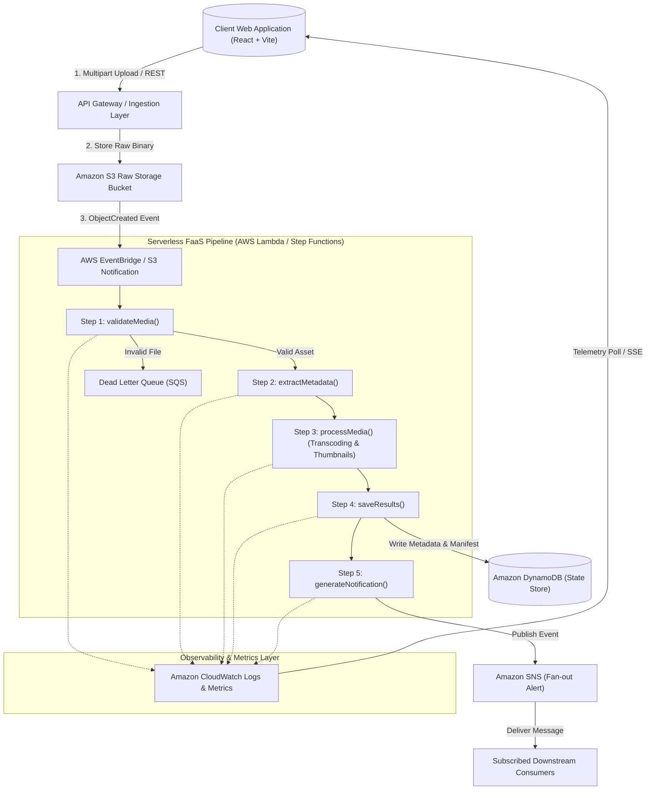

# System Architecture & Technical Design — Streamless

This document provides a comprehensive technical breakdown of the architecture, event-driven workflows, data models, and cloud design patterns implemented in **Streamless**.

---

## 1. High-Level Architecture Overview

Streamless models an asynchronous, event-driven media processing pipeline commonly deployed in high-throughput video streaming architectures (such as Netflix and YouTube). The entire workflow follows the **Choreographed & Orchestrated Serverless Pattern** described in Pogiatzis & Samakovitis (2021).

### Architecture Diagram (AWS Cloud Equivalent)



---

## 2. Pipeline Execution Stages

Every media item submitted to the system triggers an orchestrated sequence of micro-tasks. Each task represents an independent, stateless Function-as-a-Service (FaaS) execution:

```
[Raw Ingestion] 
       │
       ▼
[validateMedia] ─────────(Failure)─────────► [Dead Letter Queue]
       │ (Success)
       ▼
[extractMetadata] 
       │ (Success)
       ▼
[processMedia] (Multi-bitrate ladder)
       │ (Success)
       ▼
[saveResults] ───► [DynamoDB Write]
       │ (Success)
       ▼
[generateNotification] ───► [SNS / Push Notification]
```

### Stage 1: Ingestion & Upload (`S3 PutObject`)
- **Trigger:** HTTP POST multipart file upload or synthetic load generator.
- **Payload:** Raw binary or asset descriptors (`fileName`, `fileSize`, `mimeType`).
- **AWS Equivalent:** User uploads asset directly to an Amazon S3 staging bucket using an S3 Presigned URL. S3 dispatches an `s3:ObjectCreated:*` event.

### Stage 2: Media Validation (`validateMedia`)
- **Execution Role:** Ensures that the uploaded binary conforms to permitted MIME specifications (`video/mp4`, `video/webm`, `audio/mpeg`, `image/png`, etc.).
- **Latency Profile:** 300ms – 700ms.
- **Failure Condition:** If the file type is unsupported or corrupted, execution terminates immediately, marking the stage as `failed` and routing the error to an execution log.

### Stage 3: Metadata Extraction (`extractMetadata`)
- **Execution Role:** Simulates running `ffprobe` / container inspection to extract technical descriptors:
  - Container format, duration, bitrate, resolution (e.g., 1080p, 4K), audio channels, and color profile.
- **Latency Profile:** 400ms – 1000ms.
- **Output:** Structured JSON metadata dictionary attached to the job state.

### Stage 4: Media Processing (`processMedia`)
- **Execution Role:** Simulates distributed video transcoding across an adaptive bitrate (ABR) encoding ladder:
  - 1080p high-bitrate rendition
  - 720p medium-bitrate rendition
  - 480p mobile rendition
  - Thumbnail sprite sheet generation
- **Latency Profile:** 800ms – 2000ms (computation-heavy stage).
- **Scalability Note:** In a production serverless architecture, this stage would fan-out in parallel across multiple Lambda functions chunking the video into 2-second segments.

### Stage 5: State Persistence (`saveResults`)
- **Execution Role:** Writes the finalized job record, rendition manifest URLs, and execution telemetry to a NoSQL database.
- **AWS Equivalent:** `PutItem` command to Amazon DynamoDB with job UUID as the Partition Key.
- **Latency Profile:** 200ms – 500ms.

### Stage 6: Notification Dispatch (`generateNotification`)
- **Execution Role:** Emits an event indicating that the asset is ready for global distribution via CDN (Content Delivery Network).
- **AWS Equivalent:** Amazon SNS Topic publishing with fan-out to Amazon SQS queues and push notification services.
- **Latency Profile:** 150ms – 400ms.

---

## 3. Concurrency, Queuing & Auto-Scaling Model

### The Queuing Engine
The backend implements a non-blocking asynchronous queue that mirrors AWS Lambda's reserved concurrency controls:

1. **Active Concurrency (`activeCount`):** Number of media processing jobs currently undergoing execution across simulated FaaS instances.
2. **Concurrency Ceiling (`maxConcurrency`):** Configurable limit (default: 5 concurrent workers) that prevents resource starvation and simulates cloud quota limits.
3. **Queue Backlog (`state.queue`):** Jobs that arrive when `activeCount >= maxConcurrency` are queued in memory in FIFO order.
4. **Queue Drain Cycle:** Whenever an active job finishes (or errors), `drainQueue()` is triggered to consume the next pending item, maintaining maximum pipeline throughput.

### Mathematical Throughput Model
- **Arrival Rate ($\lambda$):** Number of media upload events per second.
- **Service Rate ($\mu$):** $1 / \text{Average Stage Latency}$.
- **System Utilization ($\rho$):** $\frac{\lambda}{c \cdot \mu}$, where $c = \text{maxConcurrency}$.
- When $\lambda > c \cdot \mu$, the queue builds up, demonstrating the need for cloud auto-scaling.

---

## 4. Mapping: AWS Cloud Services vs. Streamless Simulation

| AWS Cloud Service | Real-World Cloud Role | Streamless Educational Implementation |
| :--- | :--- | :--- |
| **Amazon S3** | Cloud Object Store for raw & encoded media | Node.js file system (`server/uploads/`) & buffer descriptors |
| **AWS Lambda** | Stateless Function-as-a-Service compute | Asynchronous JavaScript routines with simulated compute delays & state mutation |
| **AWS Step Functions** | State machine orchestrating pipeline steps | Sequential async/await pipeline runner with stage-by-stage status tracking |
| **Amazon DynamoDB** | Low-latency NoSQL database for metadata & jobs | In-memory JavaScript Map/Array with indexed job ID queries |
| **Amazon SNS / SQS** | Pub/Sub messaging and Dead Letter Queue | Real-time circular log engine and status dispatcher |
| **Amazon CloudWatch** | Aggregated telemetry, metric charts, and logs | Live `/api/metrics` endpoint and Recharts visual dashboard |

---

## 5. Fault Tolerance & Resilience Design

1. **Graceful Error Handling:** If any single stage fails (e.g., validation rejection), downstream stages are aborted to avoid wasted compute cycles.
2. **Idempotent Job Processing:** Every job is assigned an immutable UUID upon ingestion, preventing duplicate processing if an event is redelivered.
3. **Interactive Retry Mechanism:** Failed jobs can be re-queued via `/api/jobs/:id/retry` without re-uploading the original media asset.
4. **Circular Telemetry Buffer:** Execution logs are capped at 500 entries to prevent memory leaks in the Node.js process during long-running stress tests.
